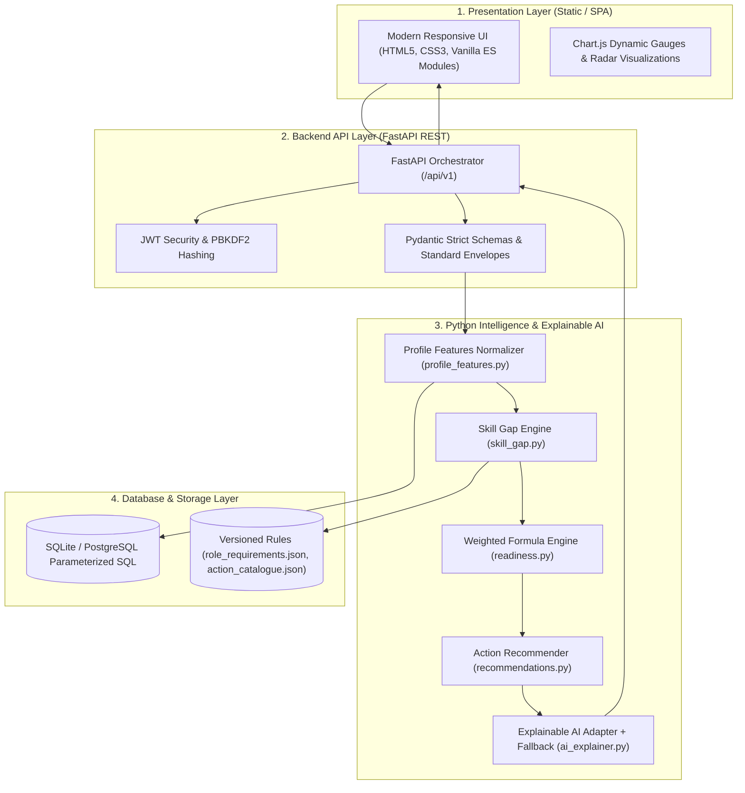

# Student Pulse AI (Prototype Stage — MSE-2)

> **Evidence → Insight → Action**  
> AI-Powered Student Success & Career-Readiness Platform  
> **Team:** Byte Force, KIET (AI Fundamentals & Python Programming)  
> **Team Members:**
> 1. Abhishek Singh Bhandari (2628mca0163)
> 2. Anubhav Kumar (2628mca0298)
> 3. Amit Kumar (2628mca0147)
> 4. Ajay Kumar (2628mca0288)

---

## 1. Quick Start (One-Command Run)

### Prerequisites
- Python 3.10+ (Tested on Python 3.14)
- Web browser (Chrome, Edge, Firefox)

### Running Locally
Run the startup script:
```powershell
# On Windows
.\run.bat
```
Or manually:
```bash
pip install -r requirements.txt
python -m uvicorn app.main:app --host 127.0.0.1 --port 8000 --reload
```
Open **[http://localhost:8000](http://localhost:8000)** in your browser.

Interactive API Swagger documentation is available at **[http://localhost:8000/docs](http://localhost:8000/docs)**.

---

## 2. Seeded Demo Accounts (Synthetic Data)

| Account | Email | Password | Profile Archetype & Purpose |
|---|---|---|---|
| **Demo 1 (Rich)** | `demo1@example.com` | `Demo@12345` | **Rich Backend Profile:** 10 verified skill evidence records, 4 assessments (avg 88.8%), 2 projects, 1 certification, target: *Backend Developer*. High readiness score (76.5%). |
| **Demo 2 (Sparse)** | `demo2@example.com` | `Demo@12345` | **Sparse Frontend Profile:** 2 skill evidence records, 1 assessment, 1 project, target: *Full-Stack Developer*. Demonstrates missing evidence handling. |
| **Demo 3 (Fresh/Empty)** | `demo3@example.com` | `Demo@12345` | **Fresh Profile:** Zero evidence, target: *Data Analyst*. Demonstrates 100% "Needs Evidence / Unknown" handling without unfair negative penalties. |

*Quick login buttons are available directly on the login screen for 1-click evaluator access.*

---

## 3. High-Level Architecture



---

## 4. Implemented Scope vs ESE Planned Enhancements

| Area / Feature | MSE-2 Status | Implementation Details / Scope |
|---|---|---|
| **Unified Student Profile** | **Implemented** | Centralizes skills evidence, assessments, projects, certifications, and target career goals. |
| **Assessment Analysis** | **Implemented** | Visualizes assessment scores, benchmark analysis, and identifies subject improvement areas. |
| **Skill-Gap Identification** | **Implemented** | Deterministic comparison against 5 target roles with explicit `"Needs evidence / Unknown"` tagging. |
| **Project Readiness** | **Implemented** | Maps completed/in-progress project capabilities against target role requirements. |
| **Interview Readiness** | **Implemented** | Analyzes verbal communication benchmarks, mock practice count, and STAR method recommendations. |
| **Personalised Action Plan** | **Implemented** | Ranked action roadmap from catalogue with status toggling (`todo` → `in_progress` → `done`) & "Why this recommendation?" modal. |
| **Explainable AI Layer** | **Implemented** | Hybrid architecture: deterministic Python rules compute facts; adapter provides friendly explanations with deterministic zero-key fallback. |
| **Privacy & Data Governance** | **Implemented** | Consent tracking, operational-only audit logging, full JSON data export, and permanent account deletion. |
| **ML-Assisted Ranking** | **Planned (ESE)** | Supervised ranking model to be trained after longitudinal student cohort placement datasets are collected. |
| **Rich Portfolio & Git Sync** | **Planned (ESE)** | Direct OAuth integration with GitHub / GitLab to parse commit history automatically. |
| **Adaptive Action Plans** | **Planned (ESE)** | Real-time adaptive replanning based on weekly student study habit tracking. |
| **Cloud Hosting & Production DB** | **Planned (ESE)** | Docker containerization, PostgreSQL cloud instance, and TLS/HTTPS production deployment. |

---

## 5. Actual Verified API Endpoint Register

| Method & Route | Purpose | Access Control | Status |
|---|---|---|---|
| `POST /api/v1/auth/register` | Student registration with mandatory consent | Public | **Verified & Tested** |
| `POST /api/v1/auth/login` | Secure authentication returning JWT Bearer token | Public | **Verified & Tested** |
| `GET /api/v1/students/me` | Retrieve authenticated student profile | Student Only | **Verified & Tested** |
| `PATCH /api/v1/students/me` | Update display name | Student Only | **Verified & Tested** |
| `GET /api/v1/students/me/evidence` | List all verified skill evidence records | Student Only | **Verified & Tested** |
| `POST /api/v1/students/me/skills` | Add new skill evidence record | Student Only | **Verified & Tested** |
| `GET /api/v1/students/me/projects` | List student projects | Student Only | **Verified & Tested** |
| `POST /api/v1/students/me/projects` | Add new project deliverable | Student Only | **Verified & Tested** |
| `GET /api/v1/students/me/certifications` | List student certifications | Student Only | **Verified & Tested** |
| `POST /api/v1/students/me/certifications` | Add student certification | Student Only | **Verified & Tested** |
| `DELETE /api/v1/students/me` | Privacy deletion of student account and all data | Student Only | **Verified & Tested** |
| `GET /api/v1/assessments` | List student assessment scores | Student Only | **Verified & Tested** |
| `POST /api/v1/assessments` | Submit new assessment score (auto-updates skills) | Student Only | **Verified & Tested** |
| `GET /api/v1/catalog/roles` | Retrieve available roles and required competencies | Public | **Verified & Tested** |
| `GET /api/v1/catalog/skills` | Retrieve system skill repository | Public | **Verified & Tested** |
| `GET /api/v1/career-goals` | Retrieve student's career goals | Student Only | **Verified & Tested** |
| `POST /api/v1/career-goals` | Create or update target career goal | Student Only | **Verified & Tested** |
| `POST /api/v1/analysis/skill-gaps` | Compute skill gaps against target role | Student Only | **Verified & Tested** |
| `POST /api/v1/analysis/readiness` | Compute transparent weighted readiness score | Student Only | **Verified & Tested** |
| `POST /api/v1/analysis/project-readiness` | Evaluate project portfolio against role requirements | Student Only | **Verified & Tested** |
| `POST /api/v1/analysis/interview-readiness` | Evaluate behavioral & interview preparedness | Student Only | **Verified & Tested** |
| `POST /api/v1/action-plans` | Generate action plan items mapped to gaps | Student Only | **Verified & Tested** |
| `GET /api/v1/action-plans/{plan_id}` | Retrieve action plan (403 if accessing another's) | Student Only | **Verified & Tested** |
| `PATCH /api/v1/action-plans/{plan_id}/items/{id}` | Update action item status (`todo`/`in_progress`/`done`) | Student Only | **Verified & Tested** |
| `GET /api/v1/health` | System health and stage liveness | Public | **Verified & Tested** |

---

## 6. How to Run Automated Tests

To run the complete automated test suite (Scenarios T01–T09, T11, T12, plus formula verification):
```bash
python -m pytest tests -v
```

All 13 test scenarios pass with 100% success rate:
- `T01`: Dashboard loads correct profile for test account
- `T02`: Incomplete profile / consent validation rejection
- `T03`: Valid assessment submission and retrieval
- `T04`: Skill-gap analysis with sufficient evidence
- `T05`: Skill-gap analysis with missing evidence (properly designated as unknown)
- `T06`: Action plan generation with reasons and relevance
- `T07`: Invalid API payload handling (controlled 422 envelope)
- `T08`: Cross-student unauthorized data access denial (403 Forbidden)
- `T09`: Explainable AI fallback test and anti-hallucination validation
- `T10`: Narrow-screen responsive layout validation (375x812 mobile viewport)
- `T11`: Secret exposure verification across frontend and codebase
- `T12`: Recommendation traceability (rule ID and evidence references)
- `Readiness Formula`: Verified transparent weighted scoring formula
